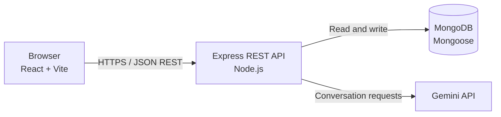

# Aarohan AI Property Concierge

**Live application:** [aarohan-ai-gamma.vercel.app](https://aarohan-ai-gamma.vercel.app/)  
**GitHub repository:** [github.com/shashankpatnam/Aarohan-AI](https://github.com/shashankpatnam/Aarohan-AI)

## Overview

Aarohan AI Property Concierge is a real-estate assistant with a public property discovery experience and a staff CRM. Buyers can explore demo projects, ask questions in an AI-powered conversation, share preferences and project interests, request help from a sales representative, and check availability and book a site visit. Staff can manage leads, handoffs and visits, and review dashboard and analytics views.

The application brings enquiries, conversations and visit bookings into a shared workflow to address delayed responses, fragmented lead management and the difficulty of converting enquiries into site visits. This describes the problem the software is designed to address; no measured business outcomes are claimed.

## Features

### Buyer experience

- Explore the demo property portfolio and start a general or project-specific conversation.
- Discuss multiple projects in one chat session and ask about project details drawn from approved facts.
- Capture buyer preferences and explicit interests in projects.
- Request a callback or human assistance and provide contact details when needed.
- View available site-visit dates and time slots and submit a booking.

### Staff workspace

- Staff login and protected CRM pages.
- Browse, filter and inspect leads, including General Inquiry leads without a primary project.
- Track project interests and manage human handoff assignment and resolution.
- Review and manage site visits.
- View dashboard summaries and analytics.
- Manage staff account settings.

## AI behavior

The backend uses the Gemini API to generate conversational responses. It supplies approved project facts as context and applies safeguards against unsupported property claims. When information is missing, the assistant can route the question to a human representative rather than inventing an answer. Site-visit availability and booking conflicts are checked by backend logic; Gemini does not decide whether a slot is available.

## Technology

- **Frontend:** React, Vite, JavaScript
- **Backend:** Node.js, Express.js, JavaScript
- **Database:** MongoDB with Mongoose
- **AI:** Google Gemini API (`@google/generative-ai`)

## Architecture



The React/Vite client renders the public discovery and chat experience and the staff CRM. The Express API handles authentication, lead and visit workflows, approved-fact lookup, booking validation and analytics. MongoDB stores application records. The backend calls Gemini for conversational responses and keeps its API key out of the browser.

## Demo portfolio

The application displays six **demo portfolio** projects. They are sample application data and are not represented as confirmed live projects from the original client scenario.

- Skyline Residences
- Green Valley Phase 2
- Riverfront Heights
- Palm Grove Villas
- Orchid Park Residences
- Terrace Gardens

## Run locally

### Prerequisites

- Git
- Node.js 20.19+ (or 22.12+) and npm. These versions satisfy the Vite 8 runtime requirement.
- MongoDB running locally, or a MongoDB connection URI. A replica set may be needed for database operations that use transactions; local standalone development supports the app's transaction fallback paths.
- A Gemini API key for live AI chat. The rest of the application can be started without it, but AI responses will not be available.

### Clone

Replace the placeholder with the repository URL when cloning from a different source:

```bash
git clone https://github.com/shashankpatnam/Aarohan-AI.git
cd Aarohan-AI
```

### Backend

In a terminal at the repository root:

```bash
cd server
npm install
Copy-Item .env.example .env
```

On macOS/Linux, use `cp .env.example .env` instead of `Copy-Item`.

Edit `server/.env`. Set a private `STAFF_JWT_SECRET` and a `STAFF_SETUP_SECRET` of at least 16 characters. Add your Gemini API key for AI chat. The example MongoDB URI uses a local database named `aarohan`; make sure MongoDB is running and update `MONGODB_URI` if necessary.

Start the API:

```bash
npm run dev
```

The API listens at `http://localhost:5000` by default; health check: `http://localhost:5000/api/health`.

#### Create the first staff administrator

The login page does not create accounts. Once the backend is running and `STAFF_SETUP_SECRET` is configured, make a one-time `POST` request to `http://localhost:5000/api/auth/setup` with JSON fields `name`, `email`, `password` (at least 10 characters) and `setupSecret` (the configured setup secret). For example, use an API client such as curl:

```bash
curl -X POST http://localhost:5000/api/auth/setup \
  -H "Content-Type: application/json" \
  -d '{"name":"Admin Name","email":"admin@example.com","password":"choose-a-strong-password","setupSecret":"your-configured-setup-secret"}'
```

This endpoint is for initial bootstrap; it refuses setup after an administrator already exists. Sign in through the client using the account you created.

### Frontend

Open a **second terminal** at the repository root:

```bash
cd client
npm install
Copy-Item .env.example .env
npm run dev
```

On macOS/Linux, use `cp .env.example .env`. The example sets `VITE_API_BASE_URL=http://localhost:5000/api`; keep the `/api` suffix and change the host/port if your backend uses a different address. Vite loads this value when it starts. Vite variables are embedded in the client bundle, so never put API keys, passwords or other secrets in `VITE_*` variables.

Open the frontend at `http://localhost:5173`. Keep the backend and frontend running in their separate terminals. The backend root endpoint is `http://localhost:5000/`.

### Load demo project facts

The demo facts are stored in `server/seeds/projectFacts.demo.json`. Once MongoDB is available and `server/.env` contains the correct `MONGODB_URI`, run this from the `server` directory:

```bash
npm run seed:project-facts
```

The seed inserts missing project records and leaves existing records unchanged. Approved facts are used by the public project summaries and Gemini context.

## Environment variables

The example files are `server/.env.example` and `client/.env.example`. The server also supports the optional runtime settings listed below; unspecified settings use built-in defaults.

### Backend (`server/.env`)

| Variable | Purpose | Required/optional |
| --- | --- | --- |
| `PORT` | HTTP port for the Express API. Defaults to `5000`. | Optional |
| `MONGODB_URI` | MongoDB connection URI. Required to start the server and run the project-facts seed. | Required |
| `CLIENT_URL` | Allowed client origin for CORS. Defaults to `http://localhost:5173` when unset. | Optional locally; set to the deployed client origin in production |
| `GEMINI_API_KEY` | Server-side credential for Gemini chat. | Optional to start; required for Gemini responses |
| `GEMINI_MODEL` | Primary Gemini model name. Defaults to `gemini-2.0-flash`. | Optional |
| `GEMINI_FALLBACK_MODEL` | Model used after primary model failures. Defaults to `gemini-2.0-flash-lite`. | Optional |
| `STAFF_JWT_SECRET` | Secret used to sign staff authentication tokens. | Required for staff authentication and initial admin setup |
| `STAFF_SETUP_SECRET` | One-time initial administrator setup secret; must be at least 16 characters. | Required only to create the initial admin |
| `GEMINI_MAX_RETRIES` | Retry count per model. | Optional |
| `GEMINI_MAX_WAIT_MS` | Maximum retry wait. | Optional |
| `GEMINI_TOTAL_BUDGET_MS` | Overall retry budget. | Optional |
| `GEMINI_CALL_TIMEOUT_MS` | Timeout for each Gemini call. | Optional |
| `GEMINI_BACKOFF_BASE_MS` | Initial retry backoff. | Optional |
| `GEMINI_BACKOFF_MAX_MS` | Maximum retry backoff. | Optional |
| `GUEST_SESSION_TTL_DAYS` | Guest-session lifetime in days; defaults to 30. | Optional |
| `STAFF_BCRYPT_ROUNDS` | Password hash cost, from 4 to 15; defaults to 12. | Optional |
| `TRUST_PROXY` | Explicit proxy hop count (1-5) when deployed behind a trusted proxy. | Optional |
| `AUTH_RATE_LIMIT_DISABLED` | Set to `true` to disable authentication rate limits. Intended for tests, not production. | Optional |
| `AUTH_RATE_LIMIT_WINDOW_MS` | Rate-limit time window. | Optional |
| `AUTH_LOGIN_IP_MAX` | Maximum login attempts per IP within the rate-limit window; defaults to 20. | Optional |
| `AUTH_LOGIN_EMAIL_MAX` | Maximum login attempts per email within the rate-limit window; defaults to 10. | Optional |
| `AUTH_SETUP_IP_MAX` | Maximum initial setup attempts per IP within the window; defaults to 10. | Optional |
| `GUEST_SESSION_CREATE_IP_MAX` | Maximum guest-session creations per IP within the window; defaults to 30. | Optional |

Never commit `server/.env` or publish secret values.

### Frontend (`client/.env`)

| Variable | Purpose | Required/optional |
| --- | --- | --- |
| `VITE_API_BASE_URL` | Public base URL for the backend API, including `/api`. Defaults in source to `http://localhost:5000/api`. | Optional locally; set for the target API when deployed |

Do not put secrets in frontend environment variables: Vite embeds `VITE_*` values in browser code.

## Tests, lint and build

Run each command from its respective directory:

| Task | Directory | Command |
| --- | --- | --- |
| Frontend tests | `client` | `npm test` |
| Backend tests | `server` | `npm test` |
| Lint | `client` | `npm run lint` |
| Production frontend build | `client` | `npm run build` |

The server package does not define a lint or production build script. These commands are documented from the package scripts; no test results are implied here.

## Project structure

```text
Aarohan-AI/
|-- README.md
|-- client/
|   |-- public/              # Static assets and project imagery
|   |-- src/
|   |   |-- components/     # Shared UI, chat, CRM and layout components
|   |   |-- context/        # Authentication and booking state
|   |   |-- data/           # Client-side demo data
|   |   |-- pages/          # Public pages and staff CRM screens
|   |   |-- services/       # API clients and browser storage
|   |   `-- utils/          # Presentation and workflow helpers
|   `-- tests/              # Frontend tests
`-- server/
    |-- config/             # Database and approved-project configuration
    |-- controllers/        # HTTP request handlers
    |-- middleware/         # Authentication and request controls
    |-- models/             # Mongoose models
    |-- routes/             # REST API routes
    |-- scripts/            # Data loading scripts
    |-- seeds/              # Demo project facts
    |-- services/           # Chat, booking, facts and lead workflows
    |-- tests/              # Backend tests and helpers
    `-- utils/              # Shared server utilities
```

## Current limitations and future work

- The portfolio and fact-sheet records are demo data. Fact-sheet loading is available through a seed script; a complete staff-facing fact-sheet administration interface is not present.
- Direct integrations with property portals and advertising platforms are not included.
- Production WhatsApp Business integration and automated reminder delivery are not included.
- The demo data and deployed app should not be treated as confirmation of actual project inventory, pricing, approvals or availability; verify those details with the sales team.

## Related documentation

No `deployment.md` or committed Technical Design Document is present in this repository.
